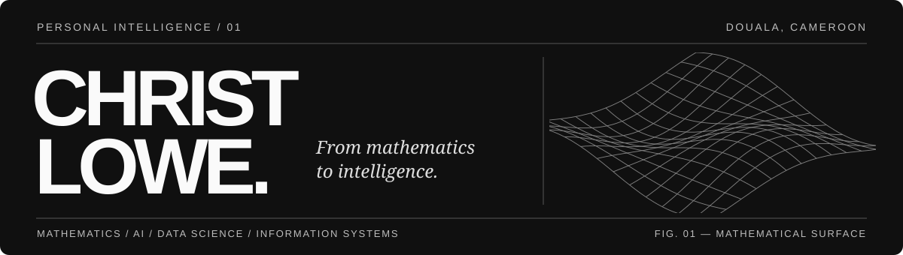

<!-- Personal profile — Monochrome Intelligence -->

  

  <strong>LINZE LOWE CHRIST MAXIME</strong> 
  <strong>AI & Data Science · Mathematics · Information Systems · Entrepreneurship</strong> 
  Mathematics graduate · Master 1 MIAGE, University of Douala · Co-founder, IMMO Digital

  <a href="https://christ-lowe-portfolio.vercel.app/en"><strong>Portfolio / EN</strong></a>
  &nbsp;·&nbsp;
  <a href="https://christ-lowe-portfolio.vercel.app/fr"><strong>Portfolio / FR</strong></a>
  &nbsp;·&nbsp;
  <a href="https://www.linkedin.com/in/linze-lowe-christ-maxime/">LinkedIn</a>
  &nbsp;·&nbsp;
  <a href="https://x.com/LoweChrist13013">X</a>
  &nbsp;·&nbsp;
  <a href="https://www.instagram.com/linzelowechrist/">Instagram</a>
  &nbsp;·&nbsp;
  <a href="mailto:christlowe6@gmail.com">Contact</a>

---

### About

I chose mathematics as the foundation for a long-standing ambition: understanding and building intelligent systems. Today, I connect mathematical reasoning, applied AI and information systems through practical engineering and entrepreneurship in Cameroon.

My work focuses on computer vision, conversational AI, machine learning and the mathematical principles underlying these systems. As co-founder of IMMO Digital, I contribute to technology solutions and the application of AI to business needs.

### Selected projects

| Project | Focus | Explore |
| :--- | :--- | :--- |
| **Vision Live** | Real-time object detection, tracking, visual memory and multimodal interaction. The repository includes a notebook and model setup documentation. | [Source code ↗](https://github.com/MaxScience-PowerAi/Vision-Live) |
| **IMMO Agent** | Conversational AI, retrieval-augmented generation, tool orchestration and enquiry qualification. | [Case study ↗](https://christ-lowe-portfolio.vercel.app/en/work/immo-agent) |
| **Personal Intelligence Platform** | Bilingual scientific portfolio, custom CMS, PostgreSQL, interactive laboratory and public-content search. | [Live platform ↗](https://christ-lowe-portfolio.vercel.app/en) |
| **Globus Engineering** | A team digitalization project undertaken with IMMO Digital in the construction sector. | [Case study ↗](https://christ-lowe-portfolio.vercel.app/en/work/globus) |
| **Mathematics for AI** | Mathematical notes, numerical linear algebra, optimization and Python experiments. | [Learning repository ↗](https://github.com/MaxScience-PowerAi/Mathematics-for-AI) |

Commercial and personal platform repositories remain private; the public case studies describe the shareable work.

### Areas of practice

| Domain | Methods and technologies |
| :--- | :--- |
| Mathematics | Linear algebra, probability, statistics, calculus, optimization |
| Data science & ML | Python, NumPy, pandas, scikit-learn, numerical experimentation |
| Computer vision | OpenCV, object detection, segmentation, tracking, visual-language models |
| Conversational AI | RAG, document retrieval, multilingual systems, agent workflows |
| Information systems | SQL, PostgreSQL, systems analysis, decision support |
| Engineering | Git, Jupyter, FastAPI, Next.js, reproducible documentation |

These are areas of practice and ongoing study, not claims of expert-level mastery.

### Scientific laboratory

I explore the relationship between mathematical theory and computational experiments through my interactive laboratory and research notes.

- [Scientific laboratory](https://christ-lowe-portfolio.vercel.app/en/lab) — browser-based mathematical and machine learning experiments.
- [Research interests](https://christ-lowe-portfolio.vercel.app/en/research) — optimization, perception and evaluation of intelligent systems.
- [Learning resources](https://christ-lowe-portfolio.vercel.app/en/resources) — explanations and exercises.

### Education and entrepreneurship

**Mathematics** — Bachelor's degree completed.

**University of Douala** — Master 1 MIAGE (2026–2027).

**IMMO Digital** — Co-founder · Information Systems, AI & Data. [Company website](https://immodigital.tech/).

---

<strong>Présentation en français</strong>

Je suis Linze Lowe Christ Maxime, également connu professionnellement sous le nom de Christ Lowe. Diplômé en mathématiques et étudiant en Master 1 MIAGE à l’Université de Douala, je développe mes compétences en intelligence artificielle, data science et systèmes d’information. Cofondateur d’IMMO Digital, je souhaite relier la rigueur scientifique aux besoins réels des organisations et contribuer au développement technologique du Cameroun et de l’Afrique.

Mes projets, mes expériences scientifiques et mon parcours sont accessibles sur mon [portfolio en français](https://christ-lowe-portfolio.vercel.app/fr).

  <em>Discipline + Work + Prayer = Success.</em> 
  Douala, Cameroon · From mathematics to intelligence.

